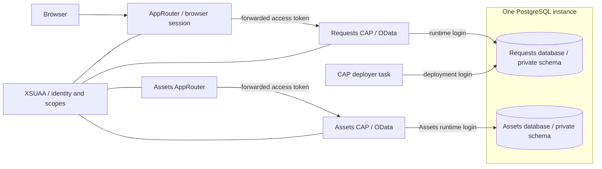

# SAP CAP + PostgreSQL on Cloud Foundry

A hands-on SAP BTP lab: build an OData API with SAP Cloud Application Programming
Model (CAP), use one PostgreSQL instance for multiple applications with isolated
data, and sign in through SAP Application Router and XSUAA.

Requests and Assets are separate CAP applications, each with its own database,
schema, runtime/deployer logins and HTML/CSS/JavaScript interface. They share the
PostgreSQL instance and XSUAA service, with separate business scopes. UI labels
and video materials are in Brazilian Portuguese. The setup and operational documentation are in English.

## Architecture



- **CAP** defines entities, exposes OData, and enforces business authorization.
- **The CAP deployer** creates and evolves tables/views from CDS models.
- **PostgreSQL technical logins** control access between applications. They are
  different from the people signing in through XSUAA.
- **XSUAA and role collections** supply user identity and business scopes.
- **AppRouter** serves the UI, handles browser login/session and forwards the token.
  The UI never stores the OAuth access token in JavaScript/local storage.

One logical database per application was chosen because the domains are independent.
The server's CPU, memory, connections, storage and availability remain shared.

## Repository map

| Path | Purpose |
| --- | --- |
| `apps/requests` | CAP model, OData service and authorization smoke test. |
| `apps/assets` | Independent Assets CAP API and authorization smoke test. |
| `apps/assets-approuter` | Assets browser login and create/edit/delete interface. |
| `apps/approuter` | Browser login, routing and a small CRUD interface. |
| `postgres/init.sql`, `compose.yaml` | Local PostgreSQL bootstrap. |
| `cloud/*.yml`, `cloud/xs-security.json` | Account-independent templates. |
| `cloud/lab.example.json` | Copy and configure for your own CF target. |
| `scripts` | Local runners, template rendering and explicit cloud operations. |
| `tools/inspect-db` | Temporary, route-free cloud database tasks. |
| `test` | Frontend and cloud-configuration tests using synthetic data. |
| `docs/video/btp-cf-006` | Editable PowerPoint, narration and demonstration scripts. |
| `VALIDATION.md` | Tested behavior and remaining limitations. |

## Prerequisites

Use **Node.js 24 LTS**, npm, Python **3.10+**, and Docker with Compose for local
PostgreSQL. The cloud path also needs CF CLI v8, a BTP CF org/space with Space
Developer access, sufficient memory/routes, an existing PostgreSQL service and
an available XSUAA `application` plan. You do not need a global CDS installation.

The shared cloud instance must allow creating databases, roles and schemas. This
was verified on a particular PostgreSQL trial environment; availability and
permissions are not assumed for your region, service plan or account.

## Quick start: local PostgreSQL and CAP

```sh
git clone https://github.com/carlosribeirodev/sap-cap-postgres-cloud-foundry.git
cd sap-cap-postgres-cloud-foundry
npm ci
npm run setup
docker compose up -d --wait
npm run deploy:requests
npm run deploy:assets
npm run check:isolation
```

`setup` creates an ignored `.env` with random local passwords and permissions 0600.
It preserves an existing file. Docker initializes two databases/private schemas and
restricted users. It only runs the SQL bootstrap on an **empty** project volume.
Changing `.env` later does not rotate passwords already stored in PostgreSQL.

Run the APIs in separate terminals:

```sh
npm run start:requests
```

```sh
npm run start:assets
```

Both local APIs use CAP development identities: `viewer` can read and `editor` can
read/write. These are mocks, not XSUAA accounts or PostgreSQL logins. They have no
configured password and are available only in the development profile.

```sh
curl --fail-with-body -u editor: \
  -H 'Content-Type: application/json' \
  -d '{"title":"Prepare the lab environment","status":"OPEN"}' \
  http://127.0.0.1:4004/odata/v4/requests/Requests
curl --fail-with-body -u viewer: \
  http://127.0.0.1:4004/odata/v4/requests/Requests
curl --fail-with-body -u viewer: \
  http://127.0.0.1:4005/odata/v4/assets/Assets
```

The local CAP servers listen on the machine's interfaces. Use a trusted development
machine; these local development runners are not production endpoints.
This quick start runs the APIs; browser SSO is covered in the cloud guide.

### What the local example simplifies

The local user owns its schema and performs both deployment and CRUD. The cloud
setup separates **deployer** and **runtime** credentials. This distinction matters:
the local example alone does not prove the cloud runtime has limited DDL privileges.

## Reproduce on SAP BTP Cloud Foundry

Follow the [complete cloud guide](cloud/README.md), including target configuration,
PostgreSQL permissions, service bindings, CAP deployment, XSUAA and AppRouter.

The short sequence, **after completing the guide's prerequisites**, is:

```sh
cp cloud/lab.example.json cloud/lab.json
# Edit cloud/lab.json for your org, space, domain, unique route suffix and PostgreSQL service.
python3 scripts/render-cloud.py
npm run build:requests
node scripts/prepare-cloud.mjs
npm --prefix apps/requests/gen/pg install --package-lock-only --ignore-scripts --no-audit --no-fund
npm --prefix apps/requests/gen/srv install --package-lock-only --ignore-scripts --no-audit --no-fund
python3 scripts/cloud-bootstrap.py
python3 scripts/cloud-deliver.py
npm --prefix apps/approuter ci
python3 scripts/cloud-approuter.py
```

Rendering only writes ignored local files. **The three cloud-operation scripts
create/update real resources** in the configured space. They verify the CLI target
before mutation. No cloud command runs as part of `npm ci`, build or tests.

To publish the second app after the first API/database setup is complete:

```sh
npm run build:assets
node scripts/prepare-cloud.mjs assets
npm --prefix apps/assets/gen/pg install --package-lock-only --ignore-scripts --no-audit --no-fund
npm --prefix apps/assets/gen/srv install --package-lock-only --ignore-scripts --no-audit --no-fund
npm --prefix apps/assets-approuter ci
python3 scripts/cloud-assets.py
```

This uses the existing Assets database and technical bindings; it does not create
another managed instance or rerun database provisioning. It publishes a separate
API/AppRouter and tests CRUD, restricted DDL and cross-database denial in **both**
directions. See the cloud guide for checkpoint recovery and route names.

Real account settings are ignored in `cloud/lab.json`. Rendered manifests and secret
checkpoint state live under ignored `.local/`. Never commit either. The example
requires no access to the author's account, URLs or external workspace directories.

## Authentication and authorization

| Layer | Purpose |
| --- | --- |
| XSUAA | Authenticate requests and provide token scopes. |
| CAP `@requires` / `@restrict` | Authorize API operations. |
| PostgreSQL technical users | Isolate databases and separate model deployment from runtime. |

Assign the matching collection to your own user in the subaccount, using the
correct identity provider, then start a fresh browser session:

| App | Read-only collection | Read/write collection |
| --- | --- | --- |
| Requests | CAP Lab Requests Viewer | CAP Lab Requests Editor |
| Assets | CAP Lab Assets Viewer | CAP Lab Assets Editor |

Deployment does not assign role collections to a person. Having a Requests role
does not grant an Assets role, even though both apps use the same XSUAA service.

No table of user passwords is required. Additional user business data would be a
separate modeling decision. Hiding a button in the UI is not an authorization check.

## Build and tests

```sh
npm run build:requests
npm run build:assets
python3 -m unittest discover -s test/cloud -p 'test_*.py'
npx playwright install chromium
npx playwright test
```

The frontend tests launch an isolated browser and use mocked API/identity responses;
they do not log into BTP or write to the cloud database. Python tests cover template
rendering, target guards and private-state handling without cloud access. To use an
existing browser installation, set `CHROME_EXECUTABLE_PATH` to its executable path.

Cloud validation distinguishes three things: SQL CRUD/isolation, CAP roles tested
with mock identities and a real PostgreSQL database, and real XSUAA token validation.
See [the validation record](VALIDATION.md) for the exact evidence and limitations.

## Important operating details

- Tables/views come from the **CAP deployer**; database/schema/login provisioning
  belongs to the infrastructure bootstrap.
- Cloud runtime has no CREATE on the persistent schema, CREATEDB, CREATEROLE or
  SUPERUSER. It does have `TEMPORARY` in its own database because the PostgreSQL
  adapter uses temporary parameter buffers for inserts.
- Each application needs its own schema/model evolution history. Different entity
  names alone do not establish an access-control boundary.
- The API binds to narrowly scoped user-provided services, not directly to the
  administrator-capable managed PostgreSQL binding.
- Isolation applies to application SQL credentials. Database and platform
  administrators remain privileged; this is not isolation from those operators.
- Those services do not rotate custom SQL passwords automatically. PostgreSQL
  credentials and the corresponding CF service must be updated together.
- The managed instance may show no directly bound apps even while custom bindings
  use its databases. Do not infer that the shared instance is unused.
- TLS certificate validation is enabled. Do not disable it to mask connection errors.
- The example uses CF manifests and tasks; it does not currently package an MTA.

## Cleanup and troubleshooting

For local data preservation:

```sh
docker compose down
```

To deliberately delete **all local project database data**:

```sh
docker compose down -v
```

Cloud cleanup and recovery procedures are in the [cloud guide](cloud/README.md).
Deleting an application does not authorize deleting the shared PostgreSQL instance.
Trial/free-plan availability, expiration, quotas and charges must be checked in your
own account. A stopped application does not establish zero infrastructure cost.

## Learning materials and references

The [video pack](docs/video/btp-cf-006/README.md) now centers on two editable slides:
one PostgreSQL instance with two isolated applications, followed by how service
bindings provide the database, user and schema to CAP. It includes a focused
walkthrough in Portuguese; the previous eight-slide deck and longer recording
outline remain available as supplementary materials.

- [CAP with PostgreSQL](https://cap.cloud.sap/docs/guides/databases/postgres)
- [CAP authentication](https://cap.cloud.sap/docs/node.js/authentication)
- [CAP authorization](https://cap.cloud.sap/docs/guides/security/authorization)
- [AppRouter configuration](https://help.sap.com/docs/btp/sap-business-technology-platform/application-router-configuration)

## License

[MIT](LICENSE). This is an independent educational lab, not an SAP product.
